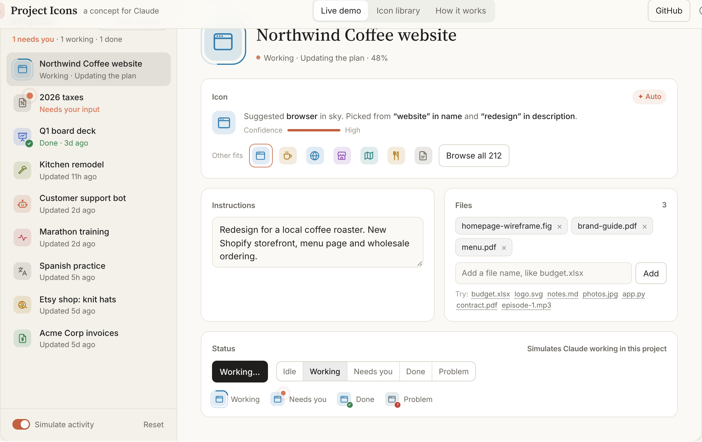
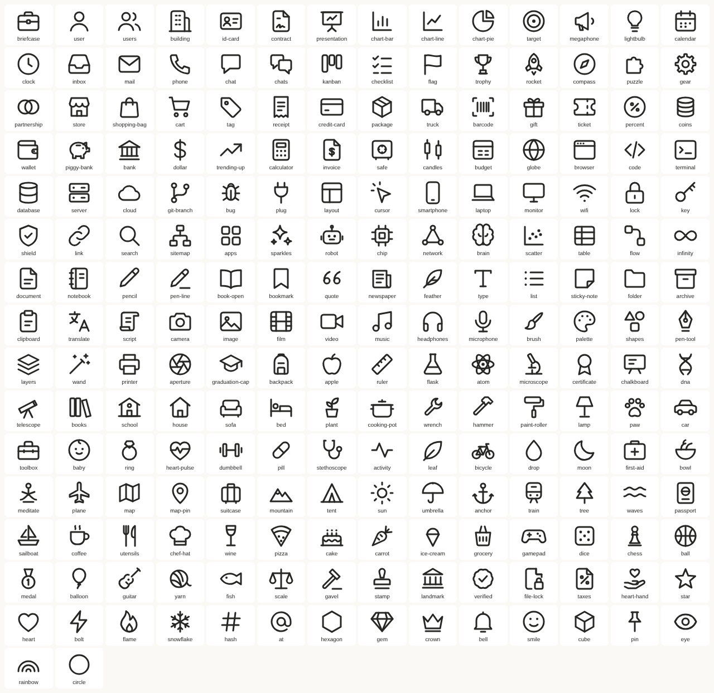
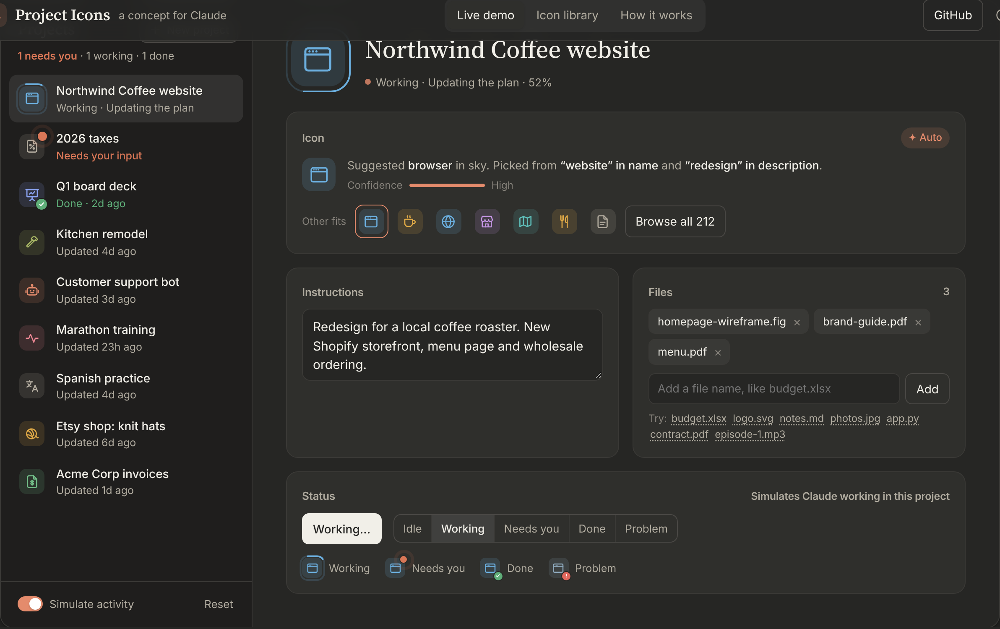

# Project Icons for Claude

A working concept for the project icons in Claude: a larger icon set drawn in one style, icons that pick themselves from what a project is about, and icons that show at a glance whether a project is working, done, or needs you.

**[Try the live demo →](https://wjddesigns.github.io/claude-icons/)**



> An independent concept shared in the spirit of community contributions. Not made by or affiliated with Anthropic. Every icon is original artwork, released under the MIT license.

## The three ideas

### 1. A set drawn for what people actually make

Today a project picks from a small set of general icons in seven colors. This set has **212 original icons in 15 groups**, covering what people really make projects for: clients and work, stores, money, websites and code, AI and data, writing, design, school, home and family, health, travel, food, hobbies, legal and admin, and symbols. Twelve colors are tuned to sit on Claude's warm neutrals in both light and dark.



#### Drawing rules

- 24 × 24 grid with a 2 point safe margin
- 1.5 stroke at 24 px, rising to 1.75 and 2 at small sizes so icons stay legible in a sidebar
- Round caps and joins, 2 point corners on large shapes
- No fills, except tiny dots drawn in `currentColor`
- In the interface each icon sits on a soft tile tinted with its color

`npm run check` enforces the rules that can be checked by machine (naming, categories, tags, fills, grid bounds).

### 2. Icons that pick themselves

When a project is created or renamed, an icon and color are suggested from its **name**, its **instructions**, and its **files** (names and extensions: a folder of `.fig` files leans toward design, receipts in a `.csv` toward money). The suggestion:

- explains itself, for example “matched ‘invoice’ in name”
- picks the color by meaning, so the sidebar groups visually
- avoids giving two sibling projects the same icon in the same color
- runs instantly on the device with no model call, so it can update while you type

Choosing an icon by hand turns auto off for that project; one click turns it back on.

```js
import { suggest } from './src/suggest.js';

suggest({ name: 'Acme Corp invoices', files: ['march.pdf', 'clients.xlsx'] });
// → { icon: 'invoice', color: 'green', confidence: 1,
//     reasons: ['“invoices” in name'], alternatives: [...] }
```

### 3. Icons that show status

| State | What you see |
| --- | --- |
| Working | A light travels around the tile, or fills it when progress is known |
| Needs you | A clay dot at the top corner that gently breathes. The only state that asks for attention |
| Done | A green check pops in once and clears when you open the project, like an unread mark |
| Problem | A steady red mark, and the icon dims |

Each state differs in position and shape as well as color. Motion stops entirely under “reduce motion”, and each state is announced to screen readers.



## Use it

**SVG files:** every icon is in [`svg/`](svg), also as a [sprite](dist/sprite.svg) and as [JSON](dist/icons.json) with names, categories and tags. The [demo's library page](https://wjddesigns.github.io/claude-icons/#library) has a one-click ZIP download.

**Web component:** `<project-icon>` draws an icon on its tile with any status, with no dependencies.

```html
<script type="module" src="src/project-icon.js"></script>

<project-icon icon="store" color="violet" size="32"></project-icon>
<project-icon icon="invoice" color="green" status="needs-input"></project-icon>
<project-icon icon="browser" color="sky" status="working" progress="0.6"></project-icon>
```

## Repository

| Path | What it is |
| --- | --- |
| `icons/icons.js` | Source of truth: every icon's markup, category and tags |
| `src/suggest.js` | The suggestion engine |
| `src/project-icon.js` | The `<project-icon>` web component with status |
| `src/app.js`, `index.html` | The demo site |
| `svg/`, `dist/` | Generated by `npm run build` |
| `tests/` | Suggestion tests, run with `npm test` |

Run it locally with `npm run build && npm start`, then open http://localhost:4173. Pushes to `main` are tested and deployed to GitHub Pages.

## Adding an icon

Add an entry to `icons/icons.js` with a kebab-case name, a category, at least four tags (the words people would use in a project name), and markup that follows the drawing rules. Then run `npm run build && npm test`.
